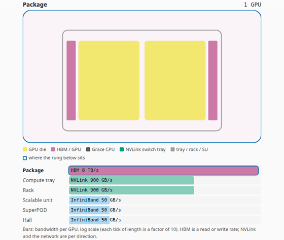
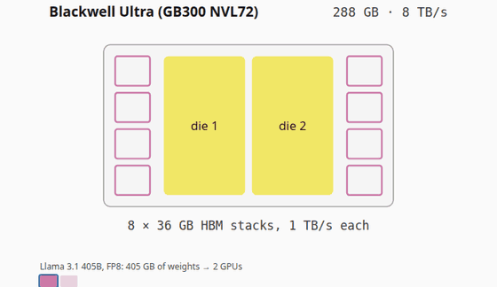
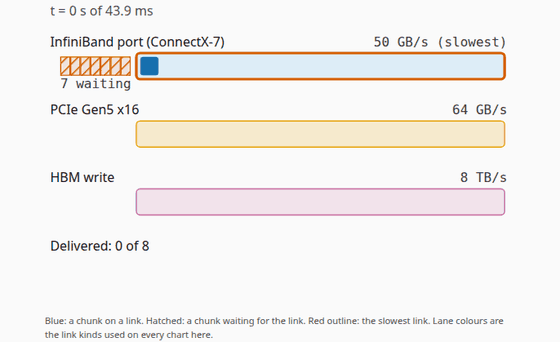
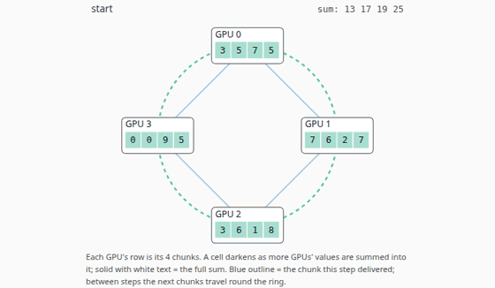
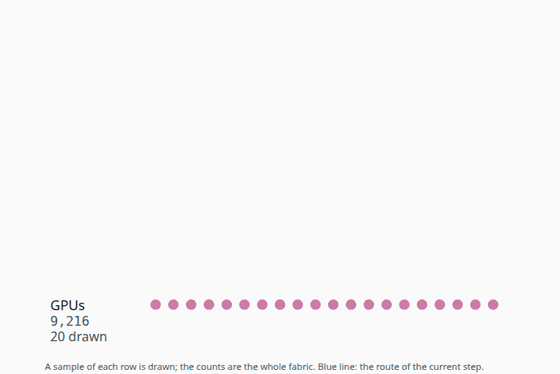
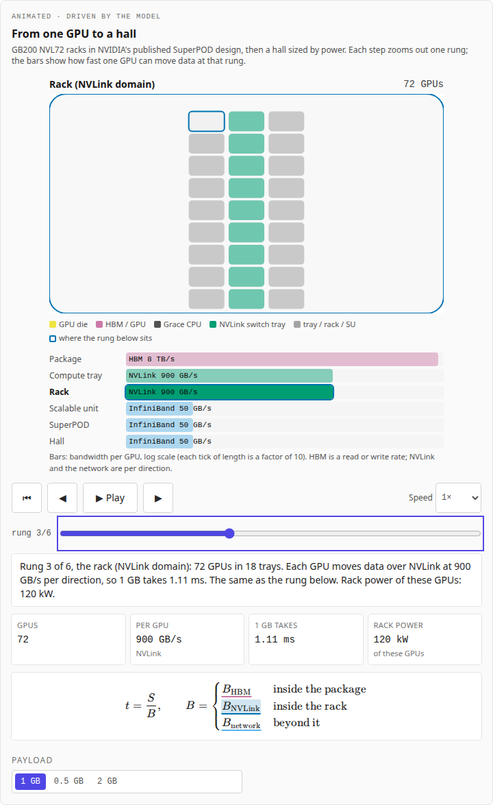
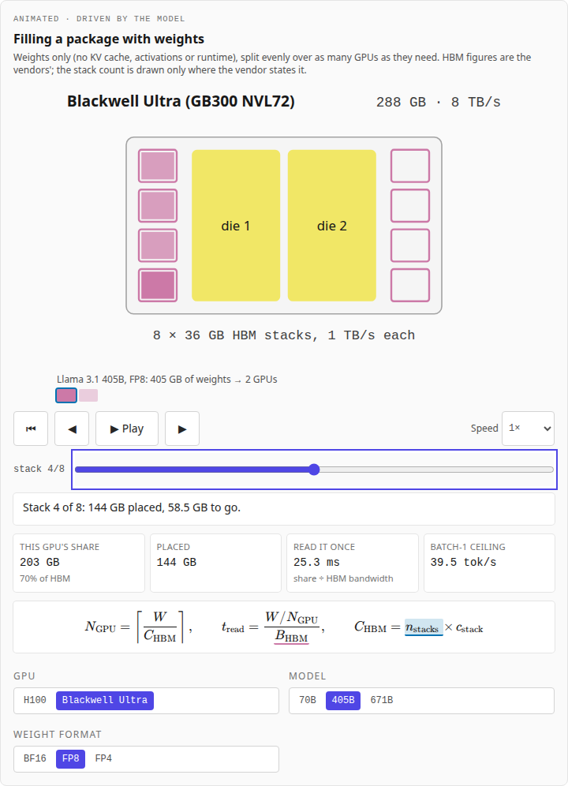
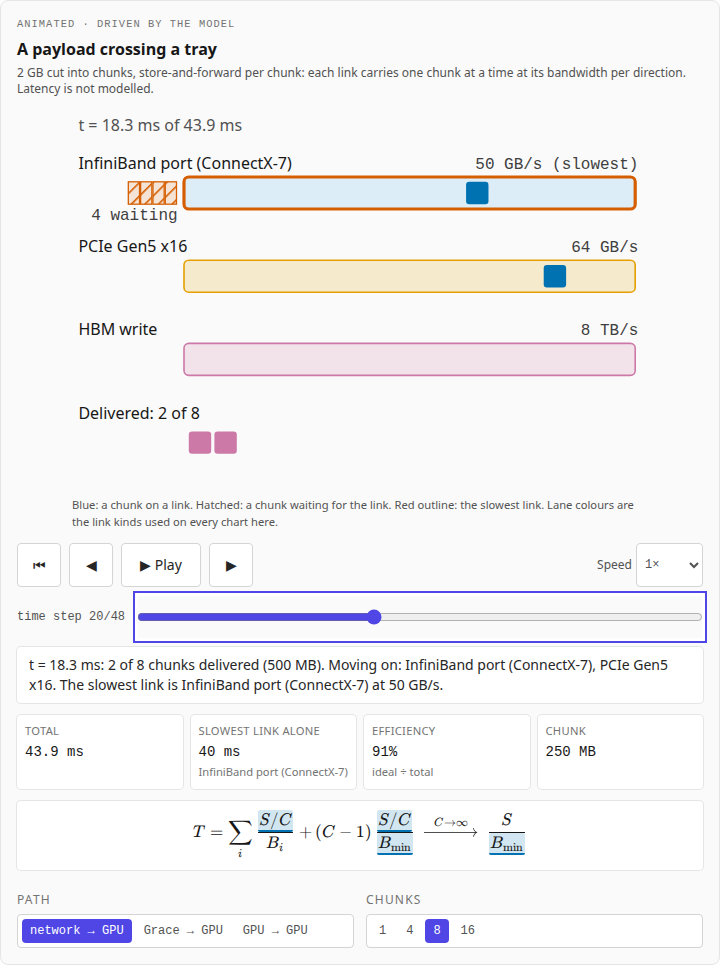
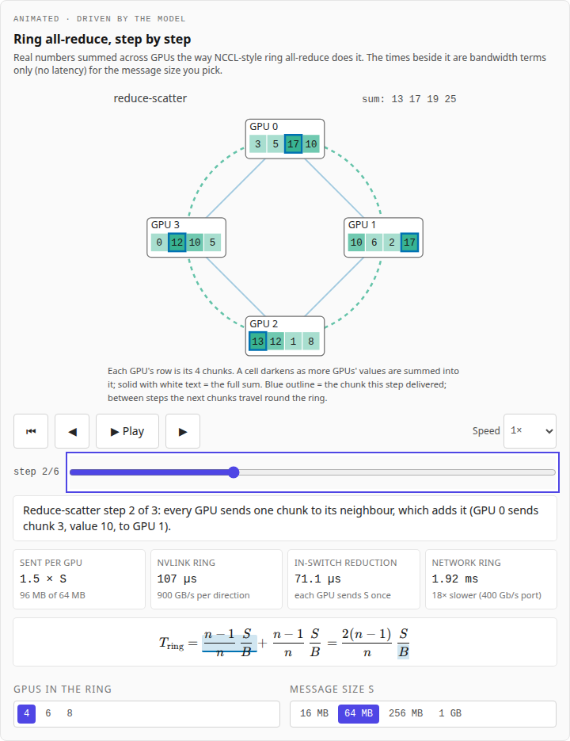
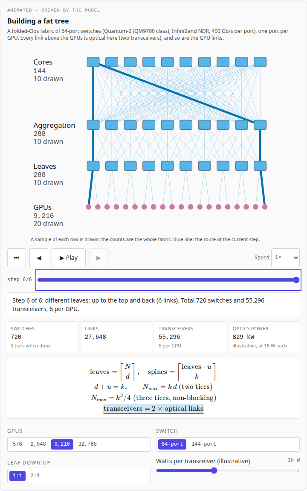

# AI Racks Explained

An animated explainer of the machines that train and serve large models,
from one GPU package to a hall of racks: the scale ladder and what crosses
each boundary, GPU packages and their HBM, compute trays and the paths data
takes through them, the NVLink rack as one domain, and the scale-out network
of leaf, spine and core switches. NVIDIA's rack-scale systems (GB200 and
GB300 NVL72, Vera Rubin NVL72) are the main worked example, because their
specifications and reference designs are published in detail. Every chapter
is built around an animation, every frame of every animation is computed by
a small **rack-scale model** whose TypeScript port matches its Python
reference exactly, and every hardware figure carries its source and the date
it was read.

It sits in the companion sites' **Hardware** track ("the machines
underneath, chip to rack"), beside
[GPU Kernels Explained](https://gpu-kernels-explained.vercel.app/) (how one
GPU executes the maths) and
[Systolic Arrays Explained](https://systolic-arrays-explained.vercel.app/)
(inside a matrix engine). The sites share one design system and link to each
other from the header, in four tracks, and the header always shows where you
are ("Track › Site"): "Foundations" (Decoder · Training), "Hardware" (Kernels
· Silicon · Racks), "Inference" (Serving · Architectures · Numerics ·
Trade-offs) and "Agents". Chapters link the
[Training](https://transformer-training-explained.vercel.app/training) and
[Serving](https://llm-inference-explained.vercel.app/) chapters they build on,
and the slides of the
[NVIDIA GPU series](https://brendanjameslynskey.github.io/LLM_Hub_NVIDIA_GPUs/).

**Live:** [ai-racks-explained.vercel.app](https://ai-racks-explained.vercel.app/)

## Part of

This repository is brief 31 of a programme of companion sites. Part A (this
state) builds the model, the sourced data and chapters 1–5; part B adds
power, cooling, disaggregated inference on racks (driven by the
[Disaggregated_Inference_Sim](https://github.com/BrendanJamesLynskey/Disaggregated_Inference_Sim)),
training clusters, other designs and cost; part C makes Racks live in the
shared site switch.

## Chapters

| #   | Chapter                                                                                         | The animation                                                                                                              |
| --- | ----------------------------------------------------------------------------------------------- | -------------------------------------------------------------------------------------------------------------------------- |
| 1   | [From chip to data centre](https://ai-racks-explained.vercel.app/learn/01-chip-to-data-centre)  | A zoom from one package out to a hall, with the bandwidth one GPU has at each rung (log scale)                             |
| 2   | [The package](https://ai-racks-explained.vercel.app/learn/02-the-package)                       | A model's weights filling a GPU's HBM stack by stack; GPUs needed and the batch-1 read floor                               |
| 3   | [Trays and nodes](https://ai-racks-explained.vercel.app/learn/03-trays-and-nodes)               | A 2 GB payload in chunks crossing the links of a GB200 tray (network, Grace memory, another GPU), store-and-forward        |
| 4   | [Scale-up: NVLink and NVSwitch](https://ai-racks-explained.vercel.app/learn/04-scale-up-nvlink) | Ring all-reduce on real numbers, timed over NVLink and over the network; the NVL72 wiring                                  |
| 5   | [Scale-out: the network](https://ai-racks-explained.vercel.app/learn/05-scale-out-network)      | A fat tree built tier by tier for the GPUs and switch you pick, then a route across it; the SuperPOD's rail-aligned design |

Coming (part B): power; cooling; disaggregated inference on racks; training
clusters; other designs; cost.

### The hero animations

Recorded frame by frame from the model's states (`pnpm animations`); WebM
versions sit beside them in [`docs/media/`](docs/media/).

| Ladder                           | Package                            | Paths                          |
| -------------------------------- | ---------------------------------- | ------------------------------ |
|  |  |  |

| Ring all-reduce              | Fat tree                         |
| ---------------------------- | -------------------------------- |
|  |  |

## Screenshots

| Ladder                                        | Package                                         |
| --------------------------------------------- | ----------------------------------------------- |
|  |  |

| Paths through a tray                    | Ring all-reduce                       | Fat tree                                  |
| --------------------------------------- | ------------------------------------- | ----------------------------------------- |
|  |  |  |

## The model

[`reference/rack_model.py`](reference/rack_model.py) is a **teaching model**,
not a simulator of any product. It computes:

- the **scale ladder** (`ladder`): GPUs, bandwidth per GPU per direction,
  time to move a payload and rack power at each rung, for GB200 NVL72 racks
  in the published DGX SuperPOD design, and a hall sized by power;
- the **package** (`package`, `fit`, `fill_steps`): capacity and bandwidth
  per HBM stack, the time to read all of HBM once, the ridge point, and how
  many GPUs a model's weights need;
- **paths through a tray** (`pipeline`, `pipeline_steps`): a payload in
  chunks crossing a chain of links, one chunk per link at a time;
- **scale-up** (`nvlink_domain`, `ring_allreduce_steps`, `allreduce_time`,
  `tp_compare`, `alltoall_time`): the NVL72 wiring and bandwidth, ring
  all-reduce on real integers, and collective times over NVLink against the
  network port;
- **scale-out** (`fat_tree`, `tree_steps`, `optics_power`, `rail_aligned`):
  two- and three-tier fat trees of k-port switches with optional leaf
  oversubscription, their switches, links and transceivers, and the
  rail-aligned rules of NVIDIA's DGX SuperPOD (GB200) reference
  architecture.

Every time is a bandwidth term (no latency, protocol overhead or
congestion). NVLink and NVLink-C2C are quoted by NVIDIA as bidirectional
totals; the model works per direction.

### Sources and statuses

Every hardware figure is a field `{v, st, src, ref}`: its value, a status
(`spec`, `derived`, `rule`, `illustrative`, `undisclosed`), a source id and
where in the source it is; every source records the date it was read
(2026-10-13). Products carry an availability: `product` (a vendor product
page lists the specifications), `preliminary` (the vendor marks them
preliminary or projected) or `planned` (the vendor gives a future date).
Where the sources used do not give a figure (for example the HBM stack count
of H200, Blackwell and Rubin, or GB300 rack power), the model stores `null`
and the site prints "not disclosed". Marketing claims are quoted in `CLAIMS`
and never used as inputs.
[`scripts/make_fixtures.py`](scripts/make_fixtures.py) writes the whole table,
the numbers the chapters use and the validation band to
[`results.md`](results.md); the site shows the same on
[/specs](https://ai-racks-explained.vercel.app/specs).

### Validation band

The model is checked against 21 published figures it does not take as
inputs: rack NVLink and HBM totals from per-GPU figures (GB200, Vera Rubin,
DGX B200), the NVL72 wiring (1,296 GPU links fill 1,296 switch ports), the
NVLink switch tray's 57.6 Tb/s, the two-tier size of a 144-port fat tree
("over 10,000 GPUs"), and every leaf, spine and core count in the SuperPOD
reference architecture's Table 3 (exact). The band is 0.9874 to 1.0368; the
two gaps from 1 are rounding in the published figures
([results.md](results.md#validation-band)).

### What is illustrative

- The hall rung: 100 MW of **rack** power divided into racks (no cooling,
  network or facility overhead).
- Weights-only memory sizing (no KV cache, activations or runtime); FP4 at
  half a byte per weight without block scales.
- The network path's PCIe Gen5 x16 host link, and one GPU pulling from one
  Grace over NVLink-C2C.
- Optics power: the watts per transceiver are a slider, because the sources
  used publish no per-port figure; every link is counted as optical.

### Checked

- `tests/python/test_rack_model.py` (pytest): every field has a known source
  and status; the ladder, package, fit and fill; the pipeline against the
  flow-shop closed form; ring all-reduce for 2 to 8 GPUs; fat trees against
  Al-Fares et al. (k³/4 hosts, 5k²/4 switches); the SuperPOD table; the
  validation band.
- Exact parity: the TypeScript port
  ([`src/lib/racks/model.ts`](src/lib/racks/model.ts)) must reproduce every
  fixture value exactly, no tolerance (`tests/unit/model.test.ts`); CI fails
  if the fixtures, `src/data/racks.json` or `results.md` are out of date.
- Frame tests: key frames of every animation equal the reference's states,
  and the captions built from them are what the page shows (unit and e2e).
- Numbers in the prose are printed from the model at build time
  (`<V of="…" />`); the few written in words are recomputed in
  `tests/unit/values.test.ts`.

## The animations

Every animation follows the family's visual standard: play and pause, step
back and forward, a scrub bar, speed from 0.25× to 4× and reset; Space and the
arrow keys when it has focus; a live caption per step, also in an
`aria-live` region; no auto-play with `prefers-reduced-motion`; paused when
scrolled out of view; the equation beside the picture, with the term the
animation is on highlighted. Colours are Okabe and Ito's colour-blind-safe
palette, the same in light and dark mode: HBM purple (as on every companion
site), scale-up links green, the network sky blue, PCIe orange, CPU memory
yellow; waiting is a warning hue **and** a hatch. On phones every SVG label
renders at 11 px or more, and rows with many switches draw fewer samples.

## Stack

The same stack as the companion sites: Next.js 14 (App Router) and
TypeScript (strict), Tailwind CSS, MDX via `next-mdx-remote` with KaTeX
rendered on the server, a Python reference with a TypeScript port and JSON
fixtures; pytest, Vitest and Playwright (every page at 1280 and 390 px, light
and dark; every animation's controls; frame tests; reduced motion; axe-core);
GitHub Actions (model and fixtures, lint, typecheck, unit, e2e, Lighthouse);
Vercel. No database and no sign-in: every page is static.

### Design system: where each piece came from

Copied from [gpu-kernels-explained](https://github.com/BrendanJamesLynskey/gpu-kernels-explained)
at commit `f1dfd1a`:

| Here                                                                                                           | From                                                                                                  |
| -------------------------------------------------------------------------------------------------------------- | ----------------------------------------------------------------------------------------------------- |
| `tailwind.config.ts`, `src/app/layout.tsx`, `src/app/learn/`, `src/lib/mdx/`, `Layer*.tsx`, `MdxTable.tsx`     | identical apart from titles and chapters                                                              |
| `src/components/ui/SiteSwitch.tsx`                                                                             | **byte-identical** to every companion site (sha256 `d9de1d09…`); Racks is "(soon)" there until part C |
| `src/components/anim/`, `src/lib/anim/`, `Controls.tsx`, `Callout.tsx`, `Eq.tsx`, `useSvgFont.ts`, `Hatch.tsx` | unchanged                                                                                             |
| `src/app/globals.css`, `src/lib/viz/palette.ts`                                                                | the link colours (`LINK_COLOUR`) and their equation highlights added                                  |
| CI, Playwright, Vitest and Lighthouse configs, `scripts/`, `RUNBOOK.md`                                        | adapted (new model, pages and chapters)                                                               |

New here: the rack model and its port, the sourced tables
(`src/components/mdx/Tables.tsx`), `/specs`, and the five widgets.

## Local development

```bash
git clone https://github.com/BrendanJamesLynskey/ai-racks-explained
cd ai-racks-explained
pnpm install
python3 -m venv .venv && .venv/bin/pip install -r reference/requirements.txt
pnpm dev                              # http://localhost:3000
```

## Changing the model

```bash
# edit reference/rack_model.py, then the same change in src/lib/racks/model.ts
.venv/bin/python -m pytest tests/python      # the reference's checks
.venv/bin/python scripts/make_fixtures.py    # regenerate src/data, the fixtures and results.md
pnpm test                                    # the port must match exactly
```

## Testing

```bash
.venv/bin/python -m pytest tests/python
pnpm lint && pnpm typecheck && pnpm format:check
pnpm test:coverage
pnpm test:e2e
pnpm lighthouse
pnpm smoke <url>
```

## Deploying

See [`RUNBOOK.md`](RUNBOOK.md): a CLI deploy from a clean `git archive`
export, then `pnpm smoke`.

## Project layout

```
content/chapters/     The MDX chapters, each opening with its animation
reference/            The Python rack-scale model
scripts/              make_fixtures, smoke-check, capture-screenshots, capture-animations
src/app/              Routes: /, /learn, /learn/[slug], /specs, /about
src/lib/racks/        The TypeScript model, the captions, the values the prose quotes
src/data/             Specifications and sources (generated by make_fixtures.py)
src/components/       Animation panel, widgets, tables, figures
tests/python/         pytest
tests/unit/           Vitest (fixtures in tests/fixtures/)
tests/e2e/            Playwright + axe-core
results.md            Every figure with its source and date, chapter numbers, validation band
```

## References

- NVIDIA product pages and documentation, read 2026-10-13: [GB200 NVL72](https://www.nvidia.com/en-us/data-center/gb200-nvl72/), [GB300 NVL72](https://www.nvidia.com/en-us/data-center/gb300-nvl72/), [Vera Rubin NVL72](https://www.nvidia.com/en-us/data-center/vera-rubin-nvl72/), [NVLink](https://www.nvidia.com/en-us/data-center/nvlink/), [DGX GB200 user guide](https://docs.nvidia.com/dgx/dgxgb200-user-guide/hardware.html), [DGX SuperPOD (GB200) reference architecture](https://docs.nvidia.com/dgx-superpod/reference-architecture-scalable-infrastructure-gb200/latest/network-fabrics.html); the full list with every figure is in [`results.md`](results.md).
- NVIDIA technical blogs: [Inside NVIDIA Blackwell Ultra](https://developer.nvidia.com/blog/inside-nvidia-blackwell-ultra-the-chip-powering-the-ai-factory-era/), [GB200 NVL72](https://developer.nvidia.com/blog/nvidia-gb200-nvl72-delivers-trillion-parameter-llm-training-and-real-time-inference/), [Hopper in depth](https://developer.nvidia.com/blog/nvidia-hopper-architecture-in-depth/), [co-packaged optics](https://developer.nvidia.com/blog/scaling-ai-factories-with-co-packaged-optics-for-better-power-efficiency/).
- Leiserson, 1985 — _Fat-trees: universal networks for hardware-efficient supercomputing_, [doi:10.1109/TC.1985.6312192](https://doi.org/10.1109/TC.1985.6312192).
- Al-Fares, Loukissas and Vahdat, 2008 — _A scalable, commodity data center network architecture_, [doi:10.1145/1402946.1402967](https://doi.org/10.1145/1402946.1402967).
- Patarasuk and Yuan, 2009 — _Bandwidth optimal all-reduce algorithms for clusters of workstations_, [doi:10.1016/j.jpdc.2008.09.002](https://doi.org/10.1016/j.jpdc.2008.09.002).
- Grattafiori et al., 2024 — _[The Llama 3 Herd of Models](https://arxiv.org/abs/2407.21783)_; DeepSeek-AI, 2024 — _[DeepSeek-V3 Technical Report](https://arxiv.org/abs/2412.19437)_ (parameter counts).
- Okabe and Ito, 2008 — _[Color Universal Design](https://jfly.uni-koeln.de/color/)_ (the palette).

## Contributing

PRs welcome. CI runs the model job (fixtures, site data and results.md up to
date; pytest), `format:check`, `lint`, `typecheck`, unit tests with coverage
thresholds, e2e on a production build, and Lighthouse CI (performance,
accessibility and best practices must each score at least 90 on `/`,
`/specs` and the five chapters).

## Licence

MIT — see [`LICENSE`](LICENSE).
